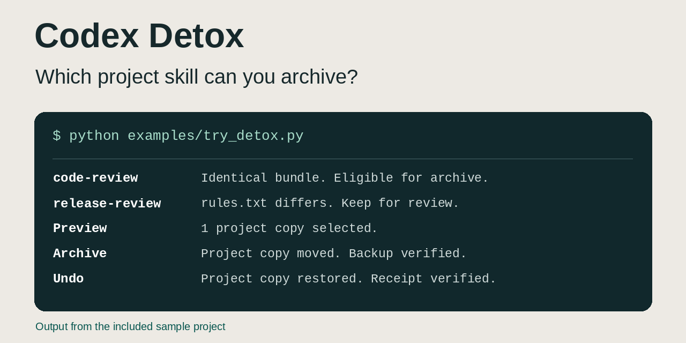

# Codex Detox · Skill audit and recovery for OpenAI Codex

**Scenario.** A developer finds two copies of each of their Codex review skills. The `code-review` copies match. The project’s `release-review` copy has an extra rule to keep the release receipt. Detox compares the instructions and helper files and shows the developer which pair differs.

**Value.** The developer can keep the project’s release rule and archive the redundant copy of `code-review`. Detox previews the move, waits for approval, and records where the backup went. If the project needs the skill again, the developer can restore it from the receipt.



*Terminal output from the included sample, rendered as an image. Run the same command to reproduce it.*

[Try the sample](#try-the-sample) · [Inspect the HTML report](examples/sample-report.html) · [Inspect the restored receipt](examples/restored-receipt.json) · [Install and use the skill](docs/run-locally.md) · [Review the test evidence](evidence/verification.md)

## Try the sample

Clone the repository or [download the source ZIP](https://github.com/jpet121/Codex-Detox/archive/refs/heads/main.zip) and extract it. Use Python 3.11 or later. Run this command from the repository folder. On Windows, you can use `py -3` in place of `python`.

```console
python examples/try_detox.py
```

The sample creates a temporary personal folder and project. It exercises the same scan, selection, preview, archive, and undo commands used by the skill. To keep the HTML report, backup records, and final receipt for inspection, run `python examples/try_detox.py --keep demo-output`. Supply a new folder for each run.

## Use it in Codex

Install the `codex-detox` folder as a personal skill. Open the project you want to inspect and say **“Detox this project.”** Select a finding with **“Preview item 1.”** Codex shows the source, the retained personal copy, and the backup path before it asks for approval. [Installation and recovery instructions](docs/run-locally.md)

| Area | What Detox checks | What you can do |
| --- | --- | --- |
| Skills | Skill names, instruction text, helper files, assets, and mode bits | Compare the bundles. Archive an eligible project copy after preview. Restore it from the receipt. |
| Instructions | Standard `AGENTS.md` and `AGENTS.override.md` files in scope | Locate repeated text by file and line. Codex can review conflicts and suggest edits. |
| Connectors | Model Context Protocol (MCP) server declarations and configuration errors | Review the finding. Runtime status and use require evidence from the host. |
| Chats | Project chat metadata when the host exposes it | Review possible idle or duplicate threads. |
| Schedules | Task state and run evidence when the host exposes them | Preview a pause. With approval and provider support, pause the task, verify its state, and later resume it. |

The local audit uses the Python standard library. Git must be available to verify repository ownership before Detox can archive a skill in a Git project. Account actions require separate host tools and authorization.

## What happens if cleanup stops?

Detox checks every selected item before the first move. It records the intended move before renaming a folder. On retry, it checks the actual project and backup paths. If an operator has already restored a file, a retry reports the changed state. If a restore destination is occupied, undo stops and preserves it. [Design and recovery behavior](docs/design.md)

## What the tests show

On Linux, all 17 regression tests passed. A separate Chromium test also passed. It selected a finding in the HTML report, downloaded the selection, and used it to preview, archive, and restore the skill. The suite includes a process exit immediately after a rename, a failure during a batch, staged and committed Git files, changed helpers, and restore collisions. The schedule tests use sample provider observations. The GitHub Actions workflow runs the regression suite on Linux, Windows, and macOS. [Results, commands, and platform scope](evidence/verification.md)

## Project origin

Codex Detox adapts the idea of a guided setup review from a Claude Detox checklist. This version uses Codex skill folders and `AGENTS.md` instructions. Its Python tools compare files, record each approved move, and recover an interrupted cleanup. [Design and recovery details](docs/design.md)
